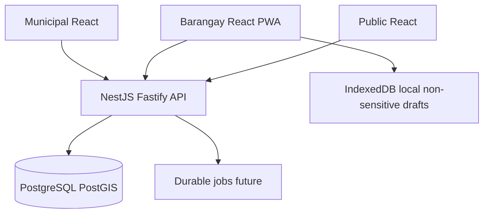

# Architecture overview

`apps/api` exposes only `/health` and `/api/v1/meta` in this foundation. All domain models are an **unapproved draft**, not functional CRUD. No administrative or personal data endpoints exist. Public map data requires approved aggregation thresholds and coordinate redaction.

Transport TLS, session design, tenant scoping, journaling, and source-of-truth reconciliation are mandatory before activating domain APIs.
